<p align="center">
  
</p>

<h1 align="center">Passel</h1>

Passel is a self-hosted browser app for mathematical research with Claude, Codex
or Gemini.
It is intended mainly for use with agentic orchestrators such as
[Danus](https://github.com/frenzymath/Danus) <sup>[✱](#codex-note)</sup> and
[Pharos](https://github.com/frenzymath/Pharos) <sup>[✱](#codex-note)</sup>, which coordinate and verify the work of several
AI agents on a mathematical problem and eventually write it up as a paper for publication. As
these apps are terminal based, Passel provides a graphical user interface to interact with them,
view their output and detach/reattach a working session.

Use it to work on several problems concurrently while the agents continue their
proof attempts in the background. Review their arguments, ask for the current
strategy or a progress report, and request a readable summary or a paper draft.
Your conversations, project files and PDF writeups stay together, whether you are
using a computer, tablet or phone.

You can run Passel on a laptop, but work on a problem can take days, so it is best
hosted on a Linux desktop or rented Linux server that stays on 24/7. The computer
running the agents needs to stay awake and connected to the internet. When the
agents run on a server, you can close your laptop and return to their work later.

<a name="codex-note"></a>✱ Danus and Pharos are written for Codex but can be adapted to Claude or Gemini.

To get started, follow the [step by step setup guide](#step-by-step-setup-guide-for-a-non-technical-audience).

## Features

- Install or update Claude, Codex and Gemini's Antigravity CLI (`agy`), and clone
  Danus and Pharos, from Settings → Setup. Choose the directory for new sessions
  in Settings → Terminal (default `~/work`).
- Use a traditional Terminal mode, showing Claude, Codex or Gemini as on the
  command line, or a Conversation mode for Claude and Codex that separates
  questions, replies and progress updates from tool output and internal activity.
- Read supported conversations with mathematical notation (LaTeX) rendered clearly.
- Search earlier discussions and bookmark useful arguments or decisions.
- Browse saved statements, proofs and notes, and open PDF writeups beside a conversation.
- Upload files for the agents to access and browse permitted project outputs,
  with workflow internals hidden.
- Organise conversations across several projects and archive completed sessions.
- Use the interface on a phone or tablet, with mobile terminal controls.
- Choose fonts, colours and reading layouts.

Gemini sessions use Antigravity CLI (`agy`) in Terminal mode. Conversation mode
currently supports Claude and Codex.

## Screenshots

The examples below follow two classical proofs: the 27 lines on a smooth complex
cubic surface (Pharos), and Dirichlet's approximation theorem (Danus). They show
the discussions, saved statements and written proofs together. The sample-project
and mobile screenshots use fictional project data.

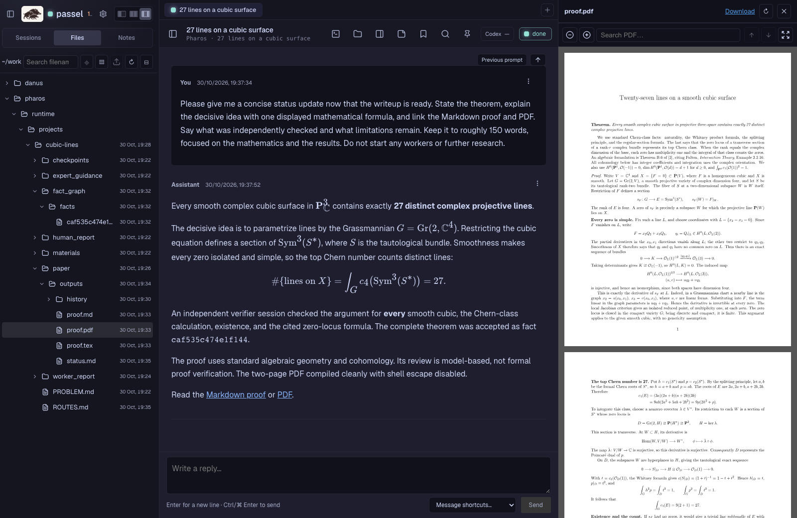

<details>
<summary>Conversations and progress reports</summary>

**Pharos: 27 lines on a smooth cubic surface.**

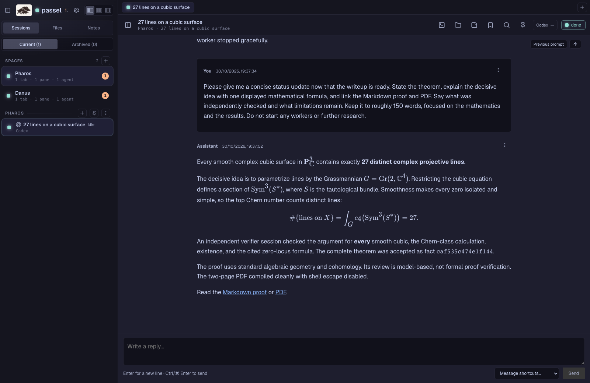

**Danus: Dirichlet's approximation theorem.**

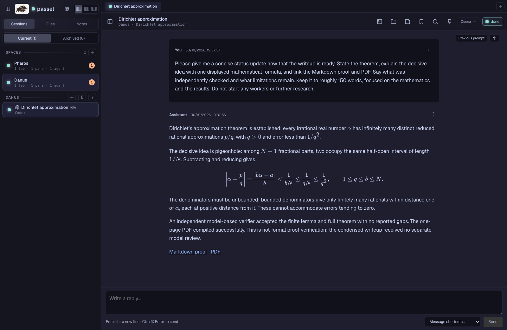

</details>

<details>
<summary>Saved statements and proofs in dark and light themes</summary>

**Reading a statement and proof alongside the discussion.**

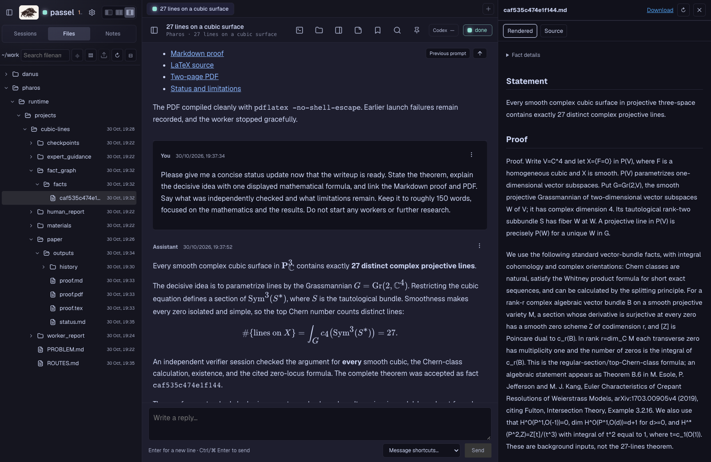

**The same proof in the light theme.**

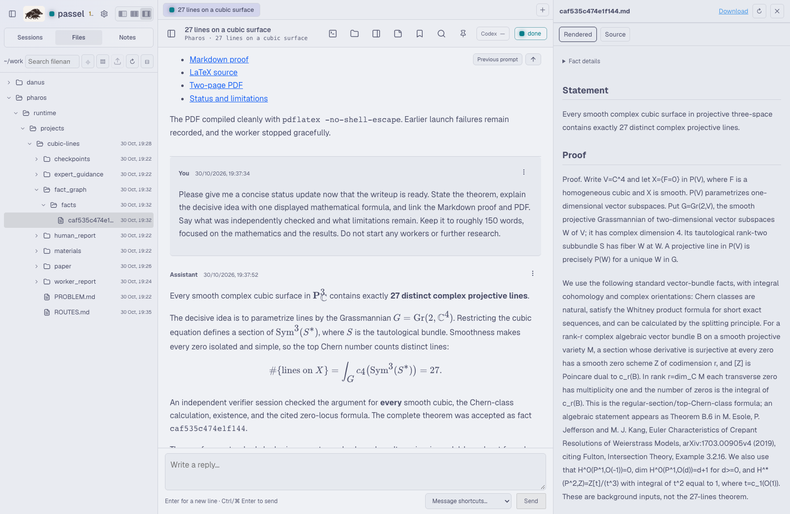

**Dirichlet's approximation theorem.**

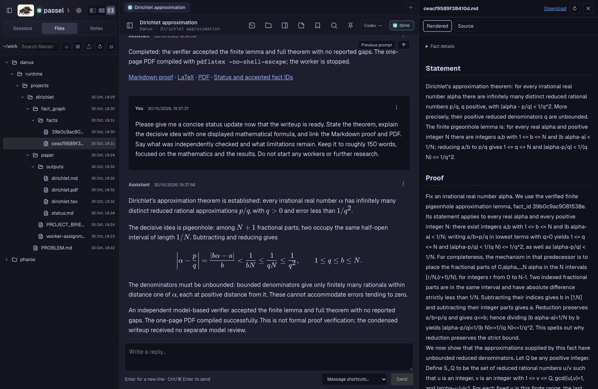

**The finite pigeonhole lemma.**

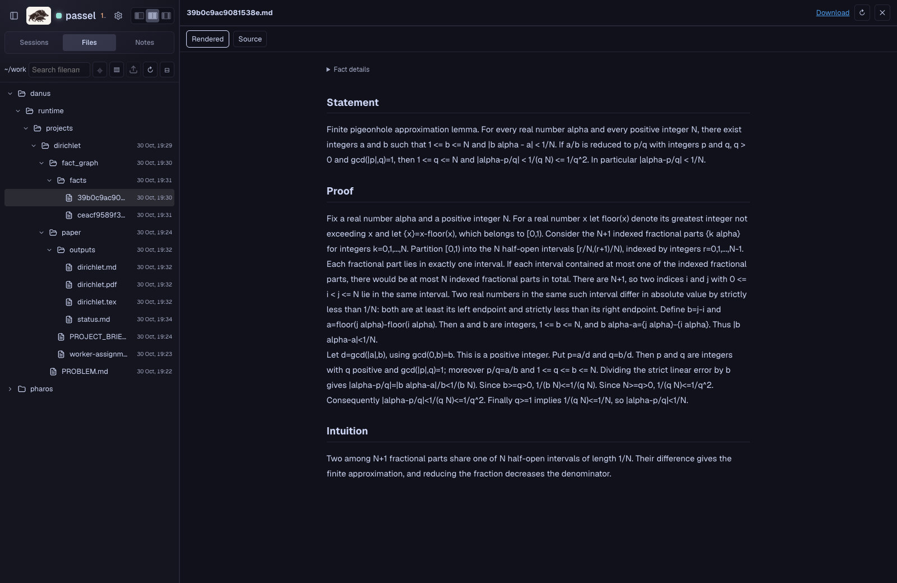

**Danus in the light theme.**

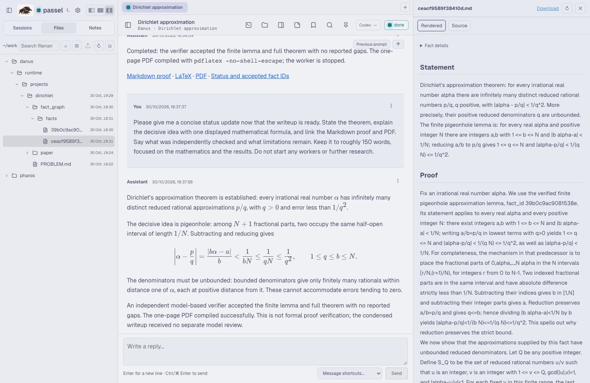

</details>

<details>
<summary>File browser and PDF reading</summary>

**Project files, saved proofs, and writeups.**

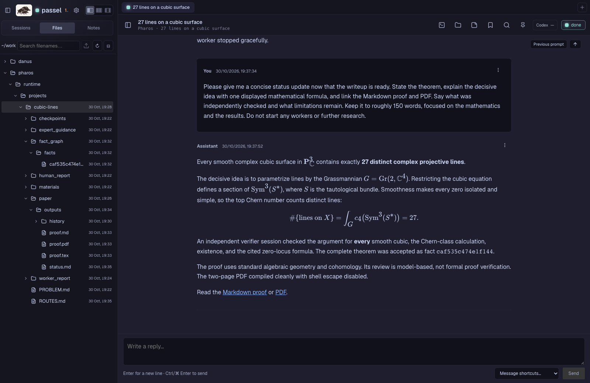

**The PDF in the wide reading layout.**

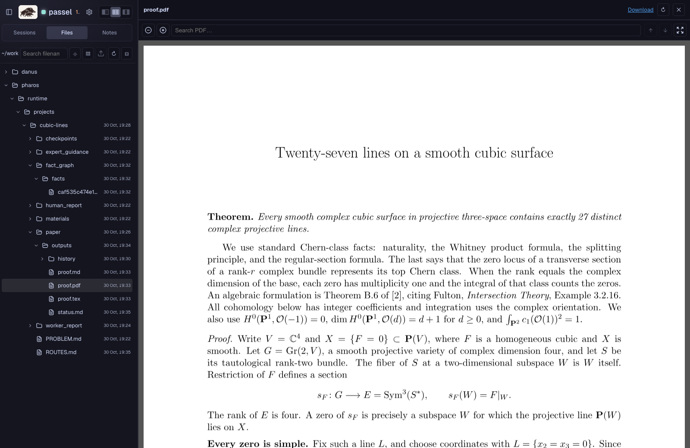

</details>

<details>
<summary>Sample project and mobile views</summary>

**Sample conversation.**

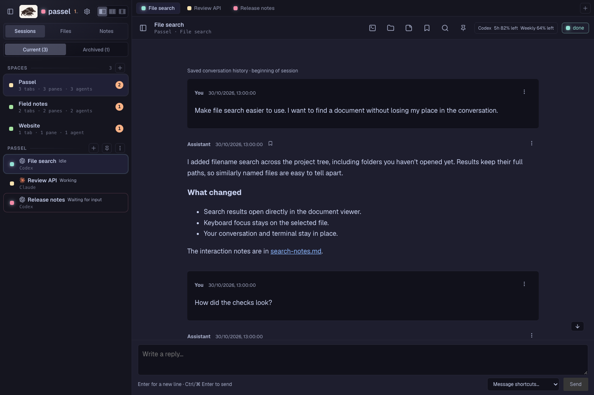

**Files, conversation, and rendered Markdown.**

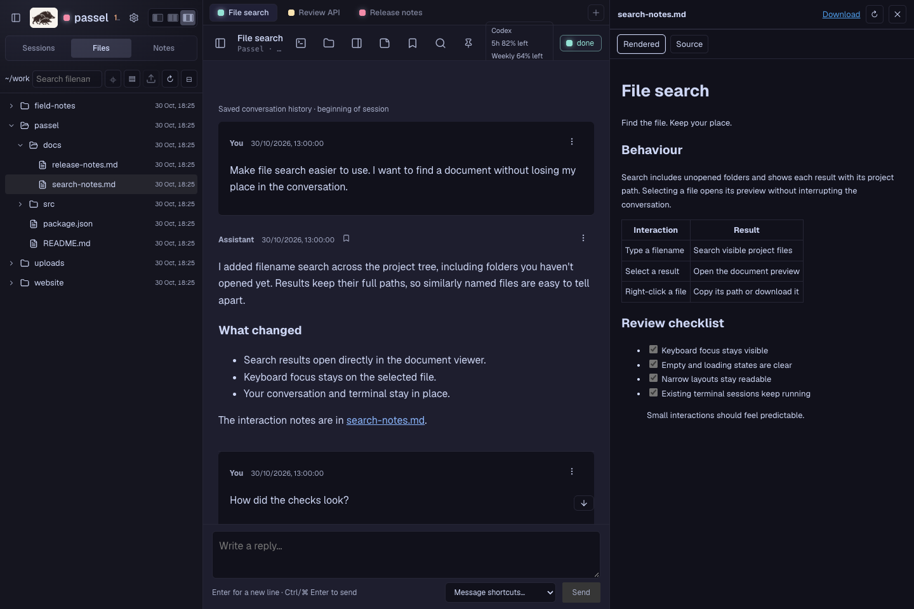

**Mobile conversation.**

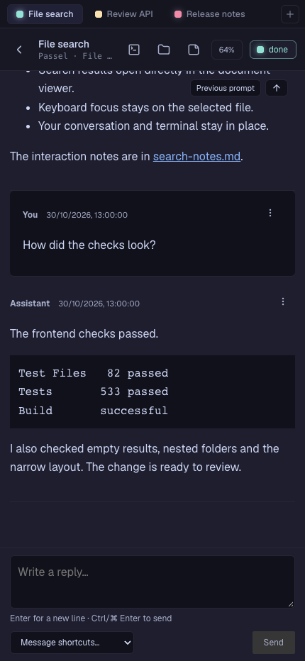

</details>

## Technical overview

Passel is a self-hosted web interface for [Herdr](https://herdr.dev/tui/),
a terminal multiplexer. It combines terminal access with a conversation view,
a project file browser, and PDF, Markdown and source previews. Herdr keeps the
terminal sessions and their agents running; Passel provides access to them through
the browser. **Native installations require a separate Herdr TUI installation**;
the guided setup below asks the installation assistant to install it. The
[Docker Compose build](docs/docker.md) includes a pinned Herdr version.

The interface also includes mobile terminal controls, file uploads, clipboard
actions, provider usage indicators, and separate reading and terminal appearance
settings. Conversation history and replies, project files and usage collection
require the supporting Python services, which currently target Linux. Running
only the Rust bridge provides the core terminal interface. This repository
supplies the components; a complete deployment needs them configured and connected
as described in [INSTALL_INSTRUCTIONS.md](INSTALL_INSTRUCTIONS.md).

The bridge executable is `passel-bridge`; desktop bundles start with `bin/passel`.
Container state lives in `~/containers/passel`; upgrades migrate the older
directory and preserve an alias when saved state needs it. Native installations,
configuration variables and browser storage keys retain their legacy identifiers
for compatibility with installed instances.

This is an independent fork of [herdr-web](https://github.com/kcosr/herdr-web),
based on its v0.5.2 release. It is not maintained or endorsed by the Herdr project.
The original MIT license and upstream attribution are retained.
The Herdr-derived compatibility code retains its Apache-2.0 licence; see
[the attribution notice](NOTICE.md).

## Step by step setup guide for a non-technical audience

You can ask a terminal-based AI assistant to do most of the installation for
you. The steps below get that assistant running; the prompts then direct it to
[INSTALL_INSTRUCTIONS.md](INSTALL_INSTRUCTIONS.md), which contains the detailed
setup instructions. Choose either the laptop example or the Linux server example;
we recommend the latter (see [Suggested setup](#suggested-setup-technical)).

You need an account with access to Antigravity CLI, Claude Code or Codex, and
permission to install software on the chosen computer. The assistant will guide you through signing in
and installing the remaining tools. Any of these three can help with installation.
Danus and Pharos use Codex by default; ask the assistant to check existing support
and make and test any adaptations needed for Claude or Gemini.

### Example 1: on your laptop

**1. Open a terminal.** On a Mac, press Command–Space, type `Terminal` and press
Return. On Linux, open the application called Terminal. On Windows, first install
Ubuntu using [Microsoft's WSL guide](https://learn.microsoft.com/en-us/windows/wsl/install),
then use the Ubuntu terminal for the commands below.

Copy commands one block at a time and press Return. You do not need to type the
surrounding backticks. `~` means your personal home folder.

Passel's web interface and terminal bridge support macOS. The full Conversation
and file experience currently targets Linux. To use these features on a MacBook,
ask the assistant to run Herdr, the research agents and their supporting services
together in a Linux virtual machine or Docker environment, then open Passel in
your Mac's browser.

**2. Install an assistant.** Choose one of Antigravity CLI, Claude Code or Codex.
The options below are listed alphabetically.

**Antigravity CLI** (for Gemini), using [Google's instructions](https://antigravity.google/docs/getting-started?tab=cli):

```sh
curl -fsSL https://antigravity.google/cli/install.sh | bash
export PATH="$HOME/.local/bin:$PATH"
agy --version
```

**Claude Code**, using [Anthropic's instructions](https://code.claude.com/docs/en/quickstart):

```sh
curl -fsSL https://claude.ai/install.sh | bash
export PATH="$HOME/.local/bin:$PATH"
claude --version
```

**Codex**, using the [official OpenAI documentation](https://learn.chatgpt.com/docs/codex/cli):

```sh
curl -fsSL https://chatgpt.com/codex/install.sh | sh
export PATH="$HOME/.local/bin:$PATH"
codex --version
```

Each version command should print a version number. Choose one assistant to begin
with. If an Ubuntu/Debian terminal says `curl` is
missing, run these commands first, then try the installer again:

```sh
sudo apt update
sudo apt install -y curl ca-certificates
```

If asked for a password, type your computer's password and press Return; it is
normal for nothing to appear while you type. If you cannot install software,
ask the person who administers the computer for help.

**3. Create your work folder and start the assistant.**

```sh
mkdir -p ~/work
cd ~/work
```

Now type `agy`, `claude` or `codex`, according to which assistant you installed,
and press Return. Follow its sign-in instructions and allow access to this work
folder when asked.

**4. Give it the installation task.** The Passel repository is
[fgounelas/passel](https://github.com/fgounelas/passel). Paste the following
message into the assistant, rather than into the ordinary terminal:

```text
Please set up Passel for mathematical research on this laptop.
The Passel repository is: https://github.com/fgounelas/passel

Put Passel in ~/work/passel, then read its AGENTS.md and
INSTALL_INSTRUCTIONS.md and follow the laptop setup instructions.
Once Passel is running, I will use Settings > Setup to install Danus, Pharos
or both. Leave that choice to me, then help finish the setup for the projects
I choose, following their installation guides and installing their packages
in the environment where the research agents run.
Check which research backends my accounts support before choosing one.
Danus and Pharos are written for Codex; if I choose Claude or Gemini for research,
check existing integrations, adapt the chosen system as needed and test it.
If this laptop needs a Linux environment, help me set that up too.
Explain any steps I must do myself in plain language.
Check that conversations, project files and PDF previews work, then give me
the browser address and simple instructions for stopping and starting again.
Do not start a research problem yet.
```

If you already have a Passel folder, give its full path instead of a repository
address and ask the assistant to reuse it. For a private repository, follow the
GitHub sign-in instructions it gives you.

**5. Open Passel.** When the assistant confirms the setup is ready, open the
address it gives you in your browser, usually `http://127.0.0.1:8787`. Keep the
laptop awake and its Linux environment running while agents are working.

**6. Install your chosen research tools.** Open **Settings → Setup** in Passel
and click **Install Danus**, **Install Pharos**, or both. The buttons download the
project files into `~/work/danus` and `~/work/pharos` in the environment where the
agents run. Projects already installed are marked **Installed**. Return to your
setup assistant and ask it to finish installing the required packages and
configuring the agents for the projects you chose.

The same Setup tab has **Install** and **Update** buttons for Claude Code, Codex
and Gemini's Antigravity CLI (`agy`), with their installed versions. After
installing your chosen assistant there, open a new **Shell** session in Passel
and type `claude`, `codex` or `agy` to sign in.

### Example 2: on a Linux server using SSH

Here the installation and research happen on the server; your laptop is used to
connect and read the results. You need the server address, SSH username and
password from its provider or administrator. An Ubuntu or Debian server is a
straightforward starting point.

**1. Connect from your laptop's terminal.** Replace the two capitalised parts:

```sh
ssh YOUR_USERNAME@YOUR_SERVER_ADDRESS
```

On the first connection, check the server fingerprint with your provider or
administrator before accepting it. Type the SSH password when the terminal asks;
the characters will not appear. Enter passwords in the terminal, not in a message
to the assistant. You are now typing on the server.

**2. Install the assistant on the server.** In this SSH window, use the
Antigravity CLI, Claude Code or Codex instructions from step 2 of the laptop
example. You do not need to install the assistant on the laptop as well. If
`sudo` asks for a password here, use your server account's password.

**3. Create your work folder and start the setup session.** Run these commands
in the ordinary SSH terminal, before starting an assistant:

```sh
mkdir -p ~/work
cd ~/work
```

Follow the instructions for the one assistant you installed:

For **Antigravity CLI**, type `agy`. Open the displayed
authorization link in your laptop's browser, sign in and paste the returned code
into the SSH terminal. See [Google's authentication instructions](https://antigravity.google/docs/install?tab=cli)
for other supported sign-in methods. Enter account secrets through the terminal,
not in the setup conversation.

For **Claude Code**, type `claude` and follow its sign-in instructions.

For **Codex**, first sign in using a device code:

```sh
codex login --device-auth
```

Open the displayed link in your laptop's browser and enter the one-time code.
Device-code login may need enabling in your ChatGPT security settings or by your
workspace administrator; see the [official sign-in instructions](https://learn.chatgpt.com/docs/auth?surface=cli).
After signing in, type `codex` to start the assistant.

Once your chosen assistant is ready, paste this message into its conversation:

```text
Please set up Passel on this Linux server for my own use.
The Passel repository is: https://github.com/fgounelas/passel

Put Passel in ~/work/passel, then read its AGENTS.md and
INSTALL_INSTRUCTIONS.md and follow the server setup instructions.
Once Passel is running, I will use Settings > Setup to install Danus, Pharos
or both. Leave that choice to me, then help finish the setup for the projects
I choose, following their installation guides and installing their packages
in the environment where the research agents run.
Danus and Pharos are written for Codex; if I choose Claude or Gemini for research,
check existing integrations, adapt the chosen system as needed and test it.
Use my own Linux account and keep the services running after SSH disconnects.
Start with private access through an SSH tunnel, using local port 8787 if free.
Check conversations, project files and PDF previews, then give me the exact
tunnel command, browser address and restart instructions.
Explain any sign-in or administrator steps I must do myself.
Do not start a research problem yet.
```

Keep the SSH window open until installation finishes. If the supplied account is
`root`, ask the assistant to create a regular account for your research work.

**4. Connect your browser.** Once the assistant confirms Passel is ready, open a
second terminal window on your **laptop**, leaving the server session open, and run:

```sh
ssh -N -L 8787:127.0.0.1:8787 YOUR_USERNAME@YOUR_SERVER_ADDRESS
```

Enter the SSH password again. A blank window is normal: it is keeping the
connection open. Visit `http://127.0.0.1:8787` in your laptop's browser. If the
assistant chose a different port, use its tunnel command and browser address
instead. Closing this tunnel window ends browser access; the server's research
sessions should continue running.

**5. Install your chosen research tools.** In your browser, open
**Settings → Setup** and click **Install Danus**, **Install Pharos**, or both.
The project files are downloaded into `~/work/danus` and `~/work/pharos` in the
server environment where the agents run. Projects already installed are marked
**Installed**. Return to the setup assistant in your SSH window and ask it to
finish installing the required packages and configuring your chosen projects.

The same Setup tab can **Install** or **Update** Claude Code, Codex and Gemini's
Antigravity CLI (`agy`) in the server environment. Open a new **Shell** session
in Passel and type `claude`, `codex` or `agy` to complete sign-in after installation.

For access from phones or for a whole research group, ask the assistant to follow
the [Suggested setup](#suggested-setup-technical) section after the private setup works.

## Docker Compose

With Docker and Compose installed, use the prebuilt GHCR image. The default
Compose file enables localhost-only browser access:

```sh
docker compose pull
docker compose up -d --wait
```

Open **http://127.0.0.1:8787**, go to **Settings → Setup**, and click
**Install Danus**, **Install Pharos**, or both. This clones the current repositories
into `~/work/danus` and `~/work/pharos` inside the container; existing files are
preserved. Follow each chosen project's installation guide to configure its
dependencies and agents.

One container includes Herdr and the supporting services. Settings → Setup also
checks installed CLI versions and offers **Install** or **Update** for Claude
Code, Codex and Gemini's Antigravity CLI (`agy`). Sign in by running `claude`,
`codex` or `agy` in a new Shell session. Projects and credentials persist in a
private Docker volume. See the
[Compose guide](docs/docker.md) for CLI setup, server access, multiple users,
backups and updates. Stopping or recreating the container stops its agent processes.

## Develop

Requirements: Node.js 22.12+ (prefer a supported LTS release), npm, Rust stable,
ripgrep (`rg`), Python 3.11+ for tests, source checks and supporting services,
and a separately installed, running
Herdr TUI instance. Reviewed terminal protocols are 20 (Herdr 0.8.2+) and
22 (Herdr 0.9.3+); unreviewed protocols are rejected.

```sh
npm ci
npm ci --prefix web
npm run dev
```

Open `http://127.0.0.1:5173`. Vite proxies the local bridge and reloads frontend
changes. Use `HERDR_SOCKET_PATH` or `npm run dev -- --session SESSION_NAME` to select
a different Herdr session. After changing the Rust bridge, rebuild it with
`npm run bridge:build` and restart the development command.

```sh
npm run source:manifest
npm run check
```

Refresh and review `SOURCE_MANIFEST.json` whenever reviewed source changes.
`npm run check` includes frontend, launcher, packaging, release-flow, Python service,
source-export and Rust checks. GitHub Actions runs these checks across supported
Node/Python versions, with Linux and macOS bridge builds and a Compose build/smoke
check. Dependency and font notices are checked against the lockfiles; see
[third-party material](third-party/README.md).

Python HTTP tests need loopback sockets. Upload tests need a temporary directory
with at least 1 GiB free. The process-observation services target Linux.

If frontend tests fail because of Node's built-in `localStorage`, run the checks
with `NODE_OPTIONS=--no-experimental-webstorage npm run check`.

## Components

| Directory | Purpose |
| --- | --- |
| `web/` | React/Vite frontend |
| `bridge/` | HTTP/WebSocket bridge |
| `vendor/herdr-compat/` | Minimal reviewed Herdr compatibility code |
| `conversation-service/` | Per-user conversation history, replies and bookmarks |
| `files-service/` | Restricted file browsing and uploads |
| `usage-service/` | Per-user usage collection |

## Deployment notes

The bridge is local-first and does not provide complete browser authentication.
Keep it bound to loopback, or put it behind an authenticated HTTPS reverse proxy.
Terminal/reply access can act as the operating-system user running the session.
Keep credentials, private transcripts, caches and deployment configuration outside
source control. Never share a user's service state with another user.

See [file service configuration](docs/danus-output-browser.md),
[conversation service](conversation-service/README.md), [usage collection](docs/usage-counter.md),
[design conventions](docs/design.md), [packaging](docs/packaging.md),
[source export](docs/source-release.md) and the [release process](docs/release.md).

## Suggested setup (technical)

For a small research group with a PI, two postdocs and three PhD students, one
option is to rent an always-on Linux virtual private server (VPS) from
[Netcup](https://www.netcup.com/en/server/vps) or
[IONOS](https://www.ionos.com/servers/vps.html), aiming for around **16 GB of RAM,
6 virtual CPU cores and 500 GB of SSD storage** as an initial estimate. Choose
the closest suitable plan or add storage. Actual needs depend on the number of
simultaneous agents and their computations; monitor usage and increase resources
as needed.

Run a separate Passel instance for each member of the group, under a separate
Linux user account with their own Herdr session, agent credentials, project files
and service state. Give each instance its own authenticated HTTPS address, keeping
its bridge and supporting services on loopback as described above. Members can
then follow their work from a laptop, tablet or phone while the server stays
online and their agents continue working.

For access, use an HTTPS reverse proxy with passkey sign-in. One option is
[Pangolin](https://docs.pangolin.net/about/pangolin-cloud-vs-self-hosted), which
uses Traefik, with [Pocket ID](https://pocket-id.org/docs/client-examples/pangolin)
as its sign-in provider. Protect each Passel instance through the gateway and
give each member access only to their own instance.

You can start an [Antigravity CLI](https://antigravity.google/docs/getting-started?tab=cli),
[Claude Code](https://code.claude.com/docs/en/quickstart) or
[Codex](https://learn.chatgpt.com/docs/codex/cli) session in
the VPS's Linux terminal and ask it to prepare and deploy this setup using Docker
Compose, including the Passel services, Pangolin/Traefik, Pocket ID, per-user
storage and access rules. The assistant will need to assemble the deployment;
this checkout does not yet include a complete Docker Compose setup. You provide
the domain and DNS access, complete the required sign-ins yourself, and each
member registers their own passkey.

Once each Passel instance is running, its user should open **Settings → Setup**
and click **Install Danus**, **Install Pharos**, or both. This clones the current
repositories into `~/work/danus` and `~/work/pharos` in that user's research
environment, preserving existing files. Ask the same assistant session to finish
installing dependencies and configuring the chosen projects. The Setup tab can
also install or update Claude Code, Codex and Gemini's Antigravity CLI (`agy`);
each user completes sign-in in their own Terminal session. Both projects are written
for Codex; ask the assistant to adapt the chosen system to Claude or Gemini if
preferred, and to test the resulting configuration.
